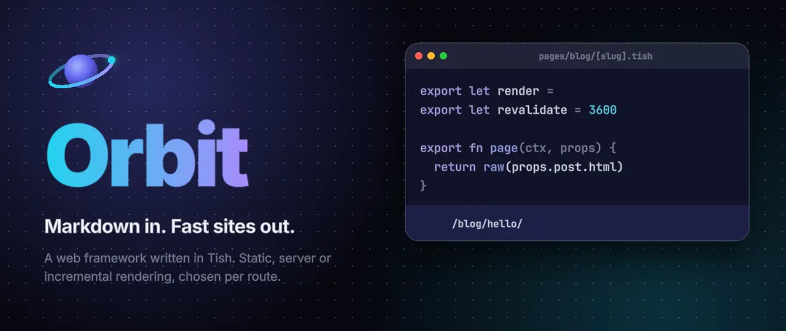
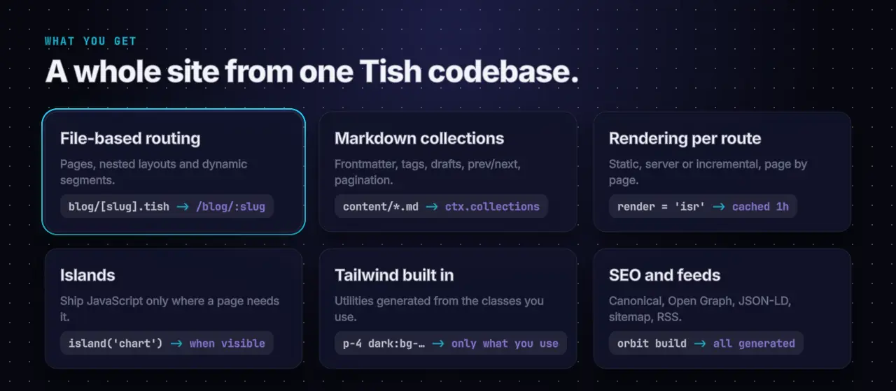
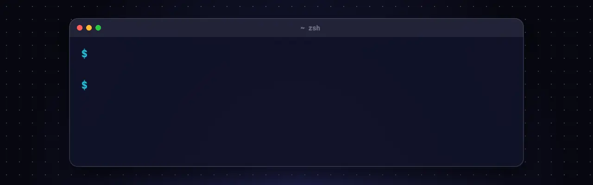

<div align="center">

<a href="https://tishlang.github.io/orbit/"></a>

**[Website](https://tishlang.github.io/orbit/)** ·
**[Docs](docs/reference.md)** ·
**[npm](https://www.npmjs.com/package/@tishlang/orbit)** ·
**[Built with Orbit: space.la](https://space.la)**

</div>

<br>

**Orbit** is a web framework for sites that start as markdown. You get file-based routes, layouts,
collections, Tailwind-style utilities, SEO and feeds. Each route chooses its own rendering: **static**
(HTML at build time), **server** (per request, streamed), or **incremental** (cached and revalidated). It's
written in [Tish](https://github.com/tishlang/tish) and runs the same code under `tish run`, Node and Vercel.



## 🚀 Get started



```sh
npx @tishlang/orbit new my-site
cd my-site && npm install && npx orbit dev
```

You get a working site with a blog, an island and a server-rendered page.
`orbit build` makes a [Vercel Build Output](https://vercel.com/docs/build-output-api) or a plain Node
server, and static pages also work on any static host.

## 🪐 A page in Orbit

```tish
// pages/blog/[slug].tish
import { raw, articleLd } from '@tishlang/orbit'

export let render = 'isr'          // 'static' (default) | 'server' | 'isr'
export let revalidate = 3600

export fn paths(ctx) { return ctx.collections.blog.map(p => ({ params: { slug: p.slug } })) }
export fn load(ctx) {
  let post = ctx.bySlug(ctx.collections.blog, ctx.params.slug)
  return post === null ? { notFound: true } : { props: { post } }
}
export fn head(ctx, props) { return { title: props.post.title, type: 'article', jsonLd: articleLd(ctx.site, props.post, props.post.url) } }
export fn page(ctx, props) { return <article class="mx-auto max-w-2xl">{raw(props.post.html)}</article> }
```

Markdown in `content/blog/` becomes `ctx.collections.blog`. Its sitemap, RSS and Atom feeds, canonical
URLs, Open Graph tags and JSON-LD are generated for you. JavaScript only ships to pages that use an
island: `{island('counter', { start: 3 }, { load: 'visible' })}`.

## ✨ What's in the box

| | |
| --- | --- |
| **Routing** | `pages/` → routes, `[slug]` and `[...path]` segments, nested `_layout.tish`, redirects, trailing-slash rules |
| **Content** | Markdown collections with frontmatter, tags, drafts, pagination and prev/next |
| **Rendering** | Static, server or ISR per route; `defer()` streams slow parts after the shell |
| **Styling** | Tailwind-style utilities generated from the classes you use, with variants, dark mode and arbitrary values |
| **Client** | Islands loaded on idle, on view or right away; link prefetch on hover |
| **SEO** | Titles, canonical, Open Graph, Twitter cards, JSON-LD, sitemap, robots.txt, RSS and Atom |
| **Deploy** | Vercel Build Output, a Node server, or any static host (with `basePath` for sub-paths like GitHub Pages) |

The full reference is in **[docs/reference.md](docs/reference.md)**: page exports, `ctx`, config, Tailwind,
build targets and tests.

## 📦 Repositories

| Repository | What's in it |
| --- | --- |
| **[orbit](https://github.com/tishlang/orbit)** | The framework, the `orbit` CLI, the starter template and [the website](site/) |
| **[tish](https://github.com/tishlang/tish)** | The language and compiler Orbit is written in |
| **[tishdoc-parse](https://github.com/tishlang/tishdoc-parse)** · **[tishdoc-render-html](https://github.com/tishlang/tishdoc-render-html)** | The markdown parser and renderer behind collections |

<br>

<sub>MIT licensed. The animations here are made with [PopCraft](https://popcraft.app); their source is in
[.github/popcraft/](.github/popcraft).</sub>
